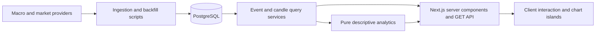
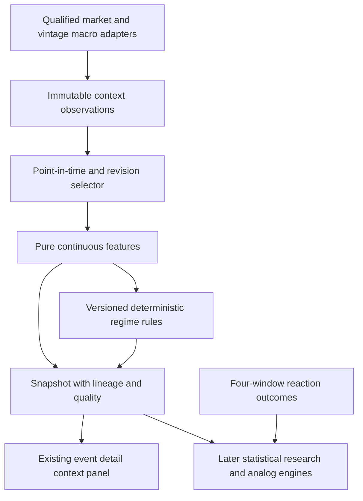

# Architecture

Updated November 5, 2026 against `3fe1585`. This document separates the current
application from the proposed V2 extension. See the [repository audit](audits/2026-11-05-repository-audit.md)
for live coverage, validation, integrity defects and evidence limits, and the
[Phase 1 plan](phase-1-market-context-plan.md) for implementation details.

## System overview

The current application is **one Next.js/TypeScript application plus standalone
TypeScript ingestion and maintenance scripts sharing PostgreSQL through Prisma**.
There is no FastAPI service or Python analytics runtime in this repository.

The database contains `events`, `data_releases`, `candles`,
`reaction_measurements`, and the legacy `asset_reactions` archive. Current
application reads use the v3 measurement table. Some legacy ingestion commands
still write the archive; the audit calls out this operational gap explicitly.

## Frontend

Next.js 16.2.6 App Router, React 19.2, TypeScript strict mode, Tailwind v4.
Server components load stored data and pass serialized values into client
islands. The event browser owns filter/search/pagination interaction;
`EventReactionExplorer` owns selected instrument/measure; `MarketChart` uses
lightweight-charts for persisted candles. Reaction charts are discrete SVG
observations, with no interpolated return path claimed as observed data.

| Route | Current behavior |
| --- | --- |
| `/` | Landing, library statistics and database-backed preview; 600-second revalidation |
| `/feed` | Server-loaded first event page, client filters and subsequent requests to `/api/events` |
| `/events/[id]` | Dynamic release details, timing/forecast provenance, measured reactions, stored candle chart and category history |
| `/patterns` | Dynamic category/instrument/measure profiles and coverage; state in URL |
| `/api/events` | GET search/filter/sort/pagination using shared query services |

Shared UI primitives and theme tokens live under `src/components/ui/` and
`src/app/globals.css`; navigation is `components/Header.tsx`. Reuse them.
IBM Plex Sans/Mono are loaded through `next/font/google`; a clean production
build currently needs access to the font host. Installed Next.js documentation
under `node_modules/next/dist/docs/` must be read before framework changes.

There is no Macro Overview, Research Lab, Analog Explorer, or AI Workspace yet.
Phase 1 adds a small event-context integration only. The five-view dashboard
is a later product milestone after the data and research layers work.

### Shared UI types

`src/types/events.ts` is the presentation contract. Its `AssetReaction` is a
measure-keyed view type, distinct from the Prisma archive model with the same
name. `measures` is a partial map of `ReactionMeasure` to measured moves;
missing keys mean unmeasured, and headline values come only from
`RELEASE_SESSION`. Session basis is carried to cross-asset displays.

`src/lib/eventCategories.ts` maps the finer stored event types to broader UI
categories. PCE is currently classified under the inflation event type; a
research filter must use canonical metric identity, not treat a whole UI
category as one statistical indicator. `src/lib/assets.ts` supplies the
12-symbol display vocabulary; they are proxies, not ES/NQ/cash-index history.

## Backend

Server-side reads belong in `src/services/`. Current event queries and mapping
live in `services/events/`, persisted candle access in `services/market/`,
canonical macro transforms/provenance in `services/macro/`, descriptive
statistics in `services/analytics/`, and Phase 1 point-in-time context in
`services/context/`: Tier-A regime feature contracts (`featureDefinitions`,
`rates`, `volatility`, market `pointInTime` eligibility) and the Phase 1.1
macro foundation (ALFRED adapter, `revisionSelect`, vintage `transforms`),
sharing `KnowledgeMode` / `MarketContextObservation` in `src/types/context.ts`
and the historical-actual gate in `services/macro/actualProvenance.ts`. These
are pure TypeScript with no persistence; Phase 1 remains NO-GO, so nothing
reads them in the product yet. The data-source registry (provider coverage,
limits, licensing, point-in-time eligibility, last validation) lives in
`services/sources/` as static metadata with pure audit functions; it never
fetches. Read-only official market-context adapters (Cboe, US Treasury, FRED
market series) live in `services/market-context/` and emit
`MarketContextObservation` rows plus retrieval provenance without touching
Prisma. Components render prepared values rather than
calculate research results. There are no application write routes or Server
Actions today, and no model calls.

`GET /api/events` parses/clamps parameters through `queryParams.ts`. Newest
sort uses display/occurrence order; biggest-move sort uses parameterized SQL
with the same current-version, trusted-timing and headline-measure predicate
as its rankable count. It does not rank by archived v2 measurements or invent
a substitute for missing release-session returns.

## Database

### Prisma setup

Prisma 7.8 uses the generated client at `src/generated/prisma` and the
`@prisma/adapter-pg` adapter. Run `npm run db:generate` after schema changes.
Schema: `prisma/schema.prisma`; SQL history: `prisma/migrations/`;
configuration: `prisma.config.ts`. Use the existing Prisma migration workflow;
do not add another ORM or migration authority.

### Hosting and endpoints

`src/lib/prisma.ts` is the application's pooled `DATABASE_URL` singleton.
`scripts/lib/prisma.ts` prefers direct `DIRECT_URL`, with a general fallback
to `DATABASE_URL`. Some sensitive maintenance/backfill tools explicitly require
the direct endpoint. Scripts load `.env` through dotenv; Next.js also considers
`.env.local`, so divergent overrides can make the app and scripts target
different databases. Never print connection strings in diagnostics.

No database changes were applied during the November audit. All four migration
ledger records matched local SQL checksums; a read-only Prisma schema diff
reported no difference from the local schema. Catalog/coverage evidence is
saved with the audit. No clean migration replay was performed; this is not a
claim of universal detection of database properties outside Prisma's scope.

### Models

| Model | Role and safeguards | Remaining limitations |
| --- | --- | --- |
| `Event` | Stable event key; display time separate from release instant/date; timing status/source; child releases and reactions | Timing metadata needs source-backed coverage; scheduled time is not proof of actual publication |
| `DataRelease` | Canonical metric fields, values, actual and forecast provenance; consensus status/as-of | One row per event/metric name; no immutable vintage/publication/availability history; live legacy fields largely unpopulated |
| `AssetReaction` | v2 fixed-column archive; separate archive constant | Live UI ignores it; old writers/repairs can still modify it |
| `Candle` | Reusable symbol/interval/open-time/basis OHLCV; nullable withheld volume; ingestion version and fetch timestamp | Sparse event windows; no immutable revision history or true native exchange calendar for all symbols |
| `ReactionMeasurement` | One event/symbol/measure/version row; non-null prices/return; explicit anchor kind, source bar stamps, canonical session days, price/session bases, provider and fetched timestamp | Input series/calendar snapshot not fully archived; application/verifier enforce numerical/temporal invariants |

Migration history is additive through the v3 table. Retain v2 and old-version
rows as evidence. Corrections to calendar/economic-close semantics require a
reaction calculation-version transition under the existing contract §6.3,
with additive recomputation and verification before a read cutover. That
transition is version 4: the engine computes v4, production reads stay on v3,
and `src/services/events/measurementWriteGate.ts` refuses every `--apply` of a
version that is neither the live read version nor covered by a committed,
evidenced cutover authorization (none exists; Phase 1 remains NO-GO).

Read-only market-context adapters in `src/services/market-context/` can fetch
VIX, Treasury yields, breakevens and Fed target bounds into lean observation
objects, but nothing persists those snapshots (or regime tags) on an event yet.

## Data pipeline

### Macro ingestion

`ingest.ts` handles curated seed events; `auto-ingest.ts` handles FRED/BLS/FOMC
candidates and deduplication. `services/macro/metrics.ts` owns canonical units,
metric keys, series bindings and transforms. FRED/BLS time-series reference
periods do not prove historical release times; bulk candidates fail closed on
reaction timing. DFEDTARU detects effective target-rate changes, omits holds,
and has inferred announcement timing until independently resolved.

Release-calendar and consensus provider contracts exist. The official-timing
seed promotion workflow is present, but no scalable authoritative historical
timing/consensus integration was found. Curated FRED retrieval supports
day-level vintage requests with latest-vintage fallback; bulk retrieval uses
current values. Those are not sufficient for historical point-in-time context.

### Reaction measurements

Pure logic: `services/events/reactionMeasurement.ts`. Provider seam:
`scripts/ingest/measurement-provider.ts`. V3 writer:
`scripts/backfill/backfill-reaction-measurements.ts`, additive and dry-run by
default with explicit apply gates. The legacy curated/bulk reaction writers
still target v2 and need an operational cutover before expanding ingestion.

| Measure | Fixed semantics |
| --- | --- |
| `INTRADAY_60M` | Pre-release intraday open, at most 2h old, to first usable open at/after +60m, at most 2h slip |
| `RELEASE_SESSION` | Prior canonical session close to release-session close |
| `SESSION_PLUS_1` | Same prior close to next canonical session close |
| `SESSION_PLUS_5` | Same prior close to close five canonical sessions after release session |

The canonical session date comes from SPY daily bars; an isolated early-close
rule controls which close follows a release. Instrument-native economic-close
logic differs for regular equities, extended futures and UTC-day crypto. A
bar stamp identifies its source observation and is not necessarily its close
or availability instant. Phase 0.5 removed the three false early closes
(2022-07-01, 2022-12-23, 2026-07-02) against official NYSE schedules, with
negative regression fixtures, under calculation version 4. Broader
context/reaction computation stays gated on qualified historical coverage.

Both observations in a measurement share a declared price basis. Never pool
measures, silently substitute another horizon, or turn missing rows into zeros.
Keep session-basis badges on cross-instrument comparisons. Release-session
returns for an intra-session announcement include pre-announcement trading.

### Candles and charts

`backfill-candles.ts` persists event windows through a provider adapter;
`services/market/candles.ts` reads only the current ingestion version and one
price basis. `EventMarketChart`/`MarketChart` display stored bars, never fetch
provider data on a page request. OHLC invariants and unknown extended-hours
volume are checked. Existing hourly coverage is only SPY/QQQ event windows,
not a daily input archive for market-context lookbacks.

### Dry-run semantics

`createDryRunPrismaClient` (`scripts/lib/readonly-prisma.ts`) blocks
model-level mutation methods and sets PostgreSQL
`default_transaction_read_only=on` on every connection, merged into the URL's
own `options` so URL parameters cannot drop it; the server refuses raw SQL
writes too. Exceptions: `guardPrismaClient` on an externally built client
(the `repair-reaction-timing` dry-run) is model-level only, and `verify-db.ts`
uses a writable client. Use read-only transactions/roles for audits and future
dry-run context writers. Existing
apply gates remain in place; do not run repair commands as verification.

## Proposed Phase 1 extension

**Not implemented.** Add a bounded context service area, not a backend rewrite:

Read-only official market adapters (`src/services/market-context/`) are the
first slice of the Sources node for VIX / Treasury / breakevens / Fed target.
They emit lean observations without Prisma writes; vintage selection and feature
math remain separate Phase 1 modules (`src/services/context/`).

Pre-release selection requires `availableAt < releaseAt`. Historical public
information reconstruction and replay of what this application actually knew
are separate query modes. A data-freeze instant and immutable vintage/input
references make reconstruction reproducible. Unknown availability, revised
latest-only values and the event's own actual/outcome cannot enter pre-release
context. Missing values have reason codes and never default to neutral regimes.

Proposed models are `ContextSeries`, `ContextObservation`, then
`MarketContextSnapshot`, `ContextFeature`, and `ContextFeatureInput`. Existing
models remain. Source/observation/publication/availability/retrieval times and
their precision are separate fields. Append revisions; reject contradictory
payloads for a purportedly immutable vintage. Store continuous features,
classification definitions/versions, input counts, missing reasons, source
citations and input edges. No provider calls during rendering.

Detailed definitions, units, thresholds, files, staged migrations, temporal
contracts, tests and six milestones are in the [Phase 1 plan](phase-1-market-context-plan.md).
The [roadmap](roadmap.md) places the audit's integrity gates ahead of this work.

## AI layer

Not built. `@anthropic-ai/sdk` is a declared dependency, not an active AI
research pipeline. Future natural-language work must translate to validated
structured queries and approved deterministic statistics. Persist research
selection, dataset/feature/measurement versions, inputs and tool outputs before
allowing explanatory prose. Cite underlying observations, expose uncertainty,
and distinguish description from out-of-sample prediction. No unrestricted
model-authored SQL or invented historical values.

## Future Python analytics layer

No Python service is present or required for Phase 1. Keep pure TypeScript
calculations and current deployment conventions. Reconsider a separate runtime
only when a specific validated statistical workload justifies its operational
cost; do not scaffold one because an earlier concept diagram mentioned it.

## Testing

## Testing

✅ **Vitest**, unit tests only, in `tests/`. `npm test` runs them; `npm run verify`
runs typecheck + lint + test. `npm run test:coverage` adds v8 coverage for the
quantitative / data-integrity modules listed in `vitest.config.mts` and fails
when thresholds drop below the measured baseline. No database, network or
browser required.

Config is `vitest.config.mts` — `.mts` so Vite loads it as ESM natively, and
`resolve.tsconfigPaths` so tests import through the same `@/` specifiers as the
app rather than a parallel set of relative paths. Coverage uses
`@vitest/coverage-v8` and writes `coverage/lcov.info` plus
`coverage/coverage-summary.json`.

| Suite | Covers |
| --- | --- |
| `tests/metrics.test.ts` | YoY / QoQ-annualised / MoM transforms, surprise arithmetic, unit and percentage-point formatting, registry integrity (every metric round-trips through its canonical name; FRED and BLS bindings agree) |
| `tests/fetch-prices.test.ts` | window resolution against synthetic candle series, including named regressions for the fabricated-0.00% bug |
| `tests/time.test.ts` | 08:30 / 14:00 ET across both DST transitions, plus a round-trip assertion |
| `tests/timing.test.ts` | the reaction-eligibility matrix, missing provenance, and status labels |
| `tests/source-timing.test.ts` | FRED/BLS reference-period-only candidates and inferred FOMC timing |
| `tests/release-calendar.test.ts` | official-record/schedule/date-only provenance, normalized release identity, DST/day boundaries and no implicit fallback instant |
| `tests/consensus.test.ts` | the provider boundary's source, HTTPS URL, finite-value and no-look-ahead checks |
| `tests/mapEvent.test.ts` | row → `NewsEvent`, null propagation, primary-window selection, category mapping is a partition |
| `tests/patternAnalysis.test.ts` | aggregation over measured moves only, sample-size reporting |
| `tests/queryParams.test.ts` | `/api/events` parameter validation and clamping |

The bias is deliberate: coverage concentrates where a bug becomes *wrong data*
rather than a wrong pixel. A mis-signed surprise or a null coerced to zero is
invisible in the UI and permanent in the database.

Database verifiers are separate from secret-free unit CI. Browser/component
tests are not an established harness yet.

📋 Still outstanding:

1. **`@testing-library/react`** for the interactive components — `EventBrowser`
   URL syncing is the one with real branching. Needs `jsdom`.
2. **Integration tests against a real Postgres** for `eventQueries.ts`. The raw
   SQL in the `biggest` sort is the part unit tests cannot reach; it was verified
   manually against a local Postgres instance.
3. **Playwright** for end-to-end.

### Continuous integration

✅ `.github/workflows/ci.yml` runs on push, pull request (`opened` /
`synchronize` / `reopened` / `ready_for_review`), and `workflow_dispatch`, with
read-only repository permissions and no database/provider secrets. A weekly
`schedule` drives the dependency audit job only. Concurrency cancels outdated
runs for the same ref.

The Quality job installs with `npm ci`, generates the gitignored Prisma client,
then runs typecheck, lint, unit tests **with coverage thresholds**,
`prisma validate` and a production build. Coverage artifacts (`lcov` +
`json-summary`) upload on every Quality run. Node comes from `.nvmrc`; npm
caching uses the lockfile.

A separate Dependency security report job runs `npm audit --omit=dev`, uploads
human-readable and JSON artifacts, and soft-fails (`continue-on-error`) so audit
noise never blocks Quality. Prefer coordinated dependency bumps over forcing
audit green in CI.

**Dependabot caveat:** same-repo `pull_request` / `push` workflows run from the
PR **head** branch. A Dependabot branch opened before `ci.yml` existed will not
schedule Quality checks until it is rebased onto a commit that includes the
workflow. Do not use `pull_request_target` to work around that — it would execute
untrusted PR code with privileged context.

---

## Deployment

There is no hosted deployment target: the app runs locally (`npm run dev`, or
`npm run build && npm run start`) against managed PostgreSQL. `vercel.json`
sets `git.deploymentEnabled: false`, so pushes and PRs no longer trigger Vercel
builds. No Docker or separate backend service is configured in this checkout. Production builds generate Prisma.
Dynamic event/pattern routes read Postgres at request time; landing data can be
prerendered/revalidated. A successful local build does not prove a deployment
or provider scheduler is configured. No deployment or production mutation was
performed in the audit.

## Conventions

Use npm and the lockfile; avoid new dependencies without a concrete need.
Keep calculations separate from UI, provider adapters separate from pure
logic, and migrations additive. Treat all timestamps/units as part of values.
Carry missingness and provenance end-to-end. Reuse existing shared UI and
Next.js conventions, reading the installed framework guides before changes.

Research outputs are descriptive until appropriate out-of-sample evaluation
supports a stronger claim. Statistical significance, predictive power and
profitability require evidence; neither a regime tag nor a large count of
cross-asset measurement rows supplies that evidence.
